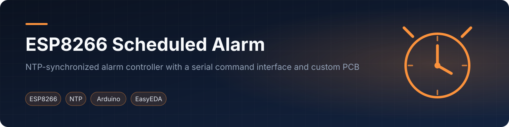
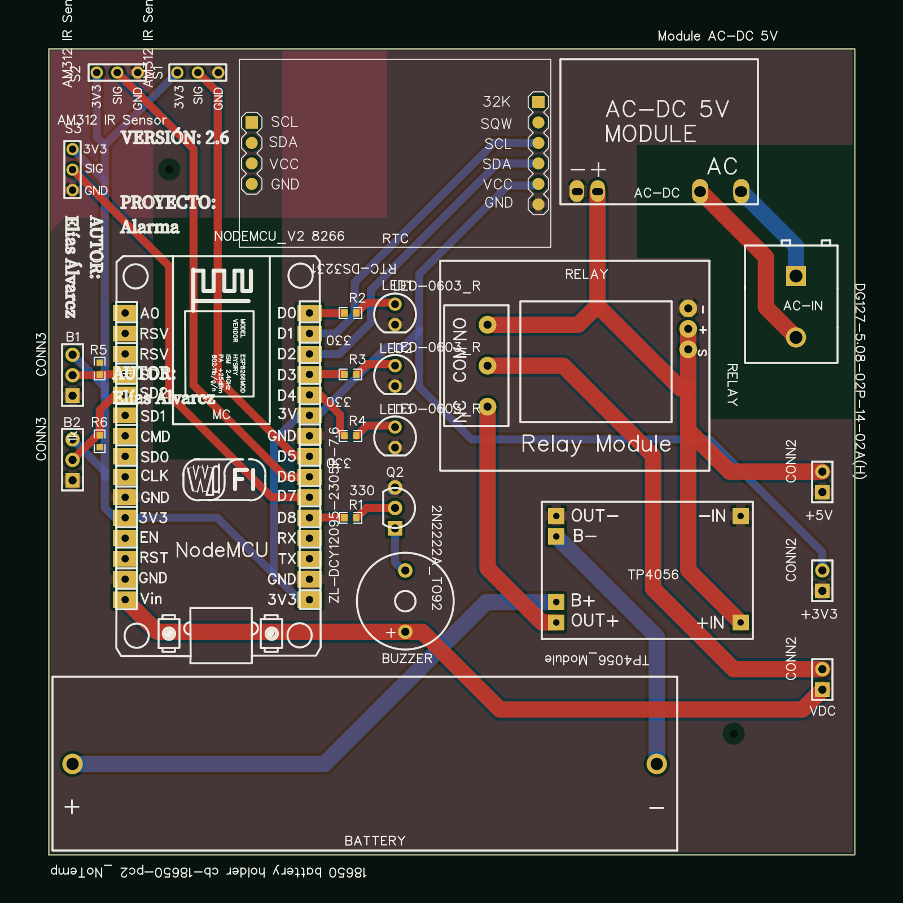
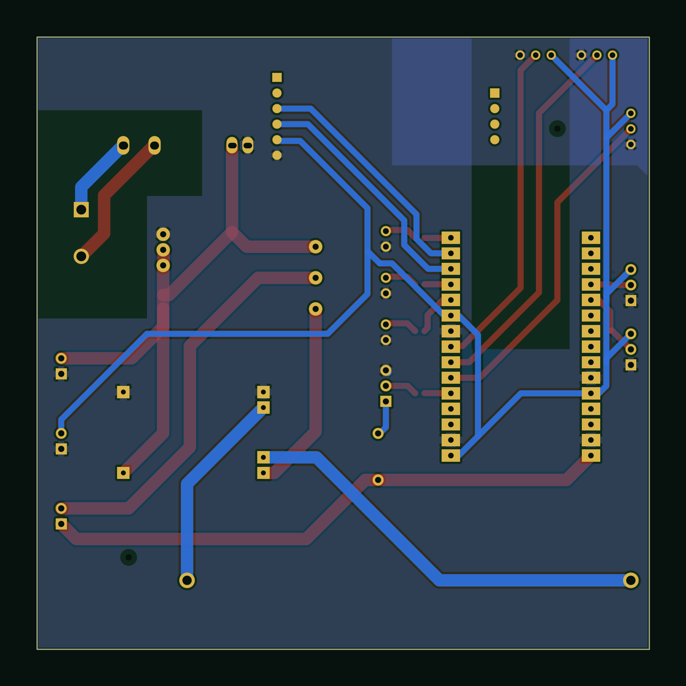

<p align="center"></p>

<p align="center">    </p>
<p align="center"><a href="#english">English</a> · <a href="#español">Español</a></p>

## English

### Overview
This alarm controller uses an ESP8266 (NodeMCU) to obtain wall-clock time from an NTP server over Wi-Fi, apply a user-defined daylight-saving window, and switch an output on and off on a daily schedule. A text command interface on the serial port handles run-time configuration. The custom EasyEDA board carries the NodeMCU, an RTC module, PIR sensors, a relay, a buzzer and battery backup.

### Features
- Time from `pool.ntp.org` via the `NTPClient` library, fixed offset UTC-3 (`-10800 s`).
- Daylight-saving (summer time) handled by two configurable dates; one hour is added while the current date is inside the summer period, with day/month/year rollover.
- Daily alarm window defined by an ON and an OFF time; windows crossing midnight are supported. The output is the on-board LED (active low).
- Automatic Wi-Fi reconnection in the main loop (20 attempts of 500 ms at start-up).
- Input validation with distinct messages for invalid and non-numerical dates/times.

Serial interface (115200 baud). Values use `/` as separator and two digits per field:

| Command | Effect |
|---------|--------|
| `set st DD/MM` | Start date of summer time (the code reads the first field as day and the second as month, although the built-in help text says `mm/dd`) |
| `set wt DD/MM` | Start date of winter time |
| `set alarm_ON hh/mm` | Alarm switch-on time |
| `set alarm_OFF hh/mm` | Alarm switch-off time |
| `led ON` / `led OFF` | Manual LED control; disables the schedule until reset |
| `help` | Prints the command list (in Spanish) |

### How time sync and DST handling work
1. `updateTime()` runs on every loop: it reads the NTP client (epoch time, converted with `gmtime` for day, month and year) into a `currentDate` record.
2. If both summer and winter start dates are set and different, `isSummerTime()` compares the current day/month with them. If the winter date comes before the summer date in the calendar (southern-hemisphere case), summer time applies outside the winter-to-summer interval; otherwise it applies between the summer and winter dates.
3. When summer time applies, `addOneHour()` advances the hour and propagates the carry to day, month and year.
4. `verifyAlarm()` compares hour and minute with the ON/OFF pair (also wrapping past midnight) and drives the LED. The alarm stays off until both times are set.

### Hardware
Parts as placed in the EasyEDA design:

| Component | Role |
|-----------|------|
| NodeMCU V2 (ESP8266) | Wi-Fi, NTP client, command interface |
| DS3231 RTC module | Real-time clock footprint on the board |
| 3x AM312 PIR sensors | Motion-sensor inputs |
| 3x LEDs with 330 Ω resistors | Indicators |
| 2N2222 transistor + buzzer | Audible output |
| Relay module | Switched output |
| AC-DC 5 V module, TP4056 charger, 18650 holder | Mains supply and battery backup |
| 2 push-button headers with resistors | User inputs |

The firmware in this repository uses the NTP time source and the on-board LED only; the PIR sensors, RTC, relay and buzzer are on the board but not driven by this sketch.

### PCB
<p align="center"> </p>

Previews are rendered from the EasyEDA Standard sources in `hardware/easyeda/`. See [`hardware/pcb/README.md`](hardware/pcb/README.md).

### Demo videos
<p align="center"><a href="https://www.youtube.com/watch?v=4bDRZ9czwoo"></a> <a href="https://www.youtube.com/watch?v=xoXKMs6CwGw"></a><br><sub>Demo 1 · Demo 2 (2023)</sub></p>

### Repository layout
```
firmware/scheduled-alarm/   Corrected 2026 Arduino sketch (.ino) and headers
firmware/original-2023/     Original sources as archived (did not compile)
  secrets.example.h         Wi-Fi credentials template (copy to secrets.h)
hardware/easyeda/           EasyEDA Standard sources (schematic, two PCB revisions)
hardware/pcb/               PCB previews
```

### Getting started
1. Install the Arduino IDE with the ESP8266 board package; select a NodeMCU 1.0 (ESP-12E) board.
2. Install the `NTPClient` library (ESP8266WiFi and WiFiUdp ship with the core).
3. Copy `firmware/scheduled-alarm/secrets.example.h` to `secrets.h` and fill in `WIFI_SSID` and `WIFI_PASSWORD` (`secrets.h` is git-ignored).
4. Upload, open the serial monitor at 115200 baud and type `help`.

Note: `firmware/scheduled-alarm/` is the corrected 2026 version (compiles; verified with PlatformIO, nodemcuv2); `firmware/original-2023/` is the original as archived (did not compile). See `firmware/CHANGES.md`. The command terminator expected by `readCommand()` is `\n` followed by `\r`.

### Credits
Designed and developed by Elías Álvarez at Universidad Católica "Nuestra Señora de la Asunción" (Paraguay), 2023.

### License
MIT, see [LICENSE](LICENSE).

---

## Español

### Descripción
Este controlador de alarma usa un ESP8266 (NodeMCU) para obtener la hora de un servidor NTP por Wi-Fi, aplicar una ventana de horario de verano definida por el usuario y activar o desactivar una salida según un horario diario. Los comandos de texto por el puerto serie permiten configurarlo en ejecución. La placa diseñada en EasyEDA incluye el NodeMCU, un módulo RTC, sensores PIR, un relé, un buzzer y respaldo de batería.

### Características
- Hora desde `pool.ntp.org` con la librería `NTPClient`, desfase fijo UTC-3.
- Horario de verano con dos fechas configurables; se suma una hora dentro del período de verano, con acarreo de día/mes/año.
- Ventana diaria de alarma (hora de encendido y apagado), incluso cruzando la medianoche. La salida es el LED integrado (activo en bajo).
- Reconexión Wi-Fi automática y validación de entradas con mensajes de error distintos.

| Comando | Efecto |
|---------|--------|
| `set st DD/MM` | Inicio del horario de verano (el código toma el primer campo como día; el texto de ayuda dice `mm/dd`) |
| `set wt DD/MM` | Inicio del horario de invierno |
| `set alarm_ON hh/mm` / `set alarm_OFF hh/mm` | Hora de encendido / apagado de la alarma |
| `led ON` / `led OFF` | Control manual del LED; desactiva el horario hasta reiniciar |
| `help` | Lista de comandos |

### Sincronización horaria y horario de verano
En cada ciclo `updateTime()` lee la hora NTP; `isSummerTime()` compara día/mes actuales con las fechas configuradas (considera el caso del hemisferio sur, donde el invierno empieza antes que el verano en el calendario); si corresponde, `addOneHour()` suma una hora. `verifyAlarm()` compara hora y minuto con el par ON/OFF y maneja el LED. La alarma permanece apagada hasta definir ambas horas.

### Hardware y PCB
Componentes según el diseño EasyEDA: NodeMCU V2, módulo RTC DS3231, 3 sensores PIR AM312, 3 LED con resistencias de 330 Ω, transistor 2N2222 con buzzer, módulo relé, módulo AC-DC 5 V, cargador TP4056 y portabatería 18650. Este firmware solo usa NTP y el LED integrado. Fuentes y vistas previas en `hardware/`.

### Videos de demostración
Ver los enlaces "Demo 1" y "Demo 2" arriba.

### Primeros pasos
Instalar el Arduino IDE con el soporte ESP8266 y la librería `NTPClient`; copiar `secrets.example.h` a `secrets.h` con la red Wi-Fi; cargar el sketch y abrir el monitor serie a 115200 baudios. `firmware/scheduled-alarm/` es la versión corregida de 2026 (compila; verificada con PlatformIO, nodemcuv2); `firmware/original-2023/` es el original tal como se archivó (no compilaba). Ver `firmware/CHANGES.md`.

### Créditos
Diseño y desarrollo: Elías Álvarez, Universidad Católica "Nuestra Señora de la Asunción" (Paraguay), 2023. Licencia MIT.
